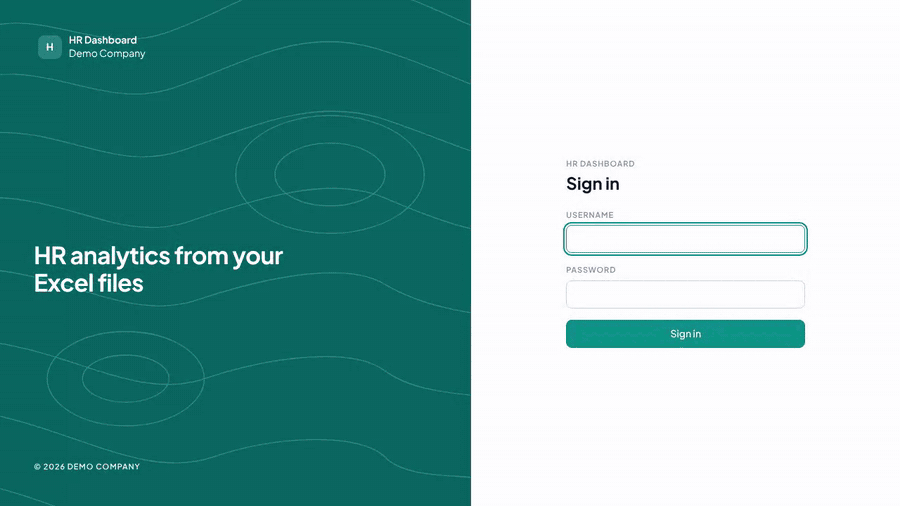

# Dashboard RH Lite

**Transformez un export Excel RH en tableau de bord des effectifs sécurisé, en quelques minutes,
sur votre propre serveur.**

[Site web](https://adel1637.github.io/hr-dashboard-lite/fr/) · [English version](README.md) · [Version Pro](#lite-ou-pro)



Dashboard RH Lite est une application web gratuite, installée chez vous, construite avec
**FastAPI, Pandas et Plotly** et une interface HTML/CSS/JS sans framework. Déposez le fichier du
personnel que vous exportez déjà de votre logiciel de paie ou RH, vérifiez la correspondance des
colonnes, et obtenez un tableau de bord des effectifs avec filtres.
Pas de cloud, pas besoin d'Internet, aucune donnée ne sort de votre réseau.

## Fonctionnalités

- **Import Excel et CSV** avec détection de l'en-tête, du séparateur et de l'encodage
- **Assistant de correspondance des colonnes** : reconnaît les en-têtes français et anglais
  (« Date d'embauche », « Hire date », « CSP », « Direction »…) et mémorise votre choix
- **Rapport de contrôle ligne par ligne**, avec le numéro de ligne Excel de chaque erreur
- **Module Effectifs** : effectif à date et variation sur la période, part en CDI, évolution
  mensuelle, répartition par service, site et catégorie
- **Filtres globaux** : date de référence, période, site, service, catégorie, contrat, sexe
- **Tableau de données** avec recherche, tri et pagination côté serveur
- **Sécurité intégrée** : mots de passe hachés (scrypt), sessions JWT, limitation des tentatives
  de connexion, Content-Security-Policy stricte, aucun secret dans le code
- Thèmes clair et sombre, français et anglais, couleur et logo configurables, affichage mobile


## Démarrage rapide

Il vous faut **Python 3.11 ou plus récent** et Git, ou simplement Docker.

**1. Télécharger et installer**

```bash
git clone https://github.com/Adel1637/hr-dashboard-lite.git
cd hr-dashboard-lite
python -m venv .venv && source .venv/bin/activate     # Windows : .venv\Scripts\activate
pip install -r requirements.txt
```

**2. Configurer** (facultatif pour un premier essai)

```bash
cp .env.example .env                                  # Windows : copy .env.example .env
```

Dans `.env`, renseignez `ADMIN_PASSWORD` et, dès que vous dépassez le simple test local,
`JWT_SECRET` (`python -c "import secrets; print(secrets.token_urlsafe(48))"`). Si vous laissez
`ADMIN_PASSWORD` vide, un mot de passe aléatoire est généré et affiché **une seule fois** dans le
terminal au premier démarrage.

**3. Créer les fichiers de démo et lancer l'application**

```bash
python demo_data/generate.py                          # fichiers fictifs de 50, 1 000 et 20 000 salariés
uvicorn app.main:app --reload
```

**4. Essayer**

1. Ouvrez <http://localhost:8000> et connectez-vous avec le compte `admin`.
2. Allez dans **Import**, choisissez `demo_data/personnel_demo_1000.xlsx`, vérifiez la correspondance
   des colonnes et confirmez.
3. Ouvrez **Tableau de bord** : effectif, évolution et répartitions suivent les filtres du haut.

Avec Docker : `docker compose up -d --build`, puis ouvrez <http://localhost:8000>.

### En cas de problème

| Symptôme | Solution |
| --- | --- |
| `python: command not found` ou erreur de version | Installez Python 3.11+, ou utilisez `python3` / `py -3.11`. |
| `uvicorn: command not found` | Activez d'abord l'environnement virtuel (`source .venv/bin/activate`). |
| Le port 8000 est déjà utilisé | Lancez `uvicorn app.main:app --port 8001` et ouvrez ce port. |
| Mot de passe administrateur perdu | Supprimez `data/users.json`, renseignez éventuellement `ADMIN_PASSWORD` dans `.env`, puis redémarrez : le compte admin est recréé. |
| L'import indique une ligne rejetée | Ouvrez le fichier Excel à la ligne indiquée. Le rapport donne la cause de chaque ligne. |
| Le numéro de ligne d'un CSV ne correspond pas à mon éditeur de texte | Le rapport compte les lignes comme Excel les affiche. Une cellule qui contient un retour à la ligne occupe une ligne dans Excel mais plusieurs dans un éditeur de texte ; le rapport le signale. |
| L'application refuse de démarrer en production | `APP_ENV=production` exige un `JWT_SECRET` d'au moins 32 caractères. |

### Votre propre fichier

Une ligne par salarié, présent ou parti. Deux colonnes seulement sont obligatoires :

| Champ | Obligatoire | Exemples d'en-têtes reconnus |
| --- | :---: | --- |
| Matricule | oui | Matricule, ID salarié, Employee ID |
| Date d'entrée | oui | Date d'embauche, Date d'entrée, Hire date |
| Date de sortie | | Date de départ, Exit date (vide si présent) |
| Sexe, date de naissance, service, site, catégorie, contrat, nom, motif de sortie | | Genre, Direction, CSP, Grade, Contrat… |

L'effectif à n'importe quelle date est calculé à partir des dates d'entrée et de sortie :
inutile d'importer un fichier par mois.

## Performances

Sur une entreprise fictive de 20 000 salariés (29 120 lignes d'historique), l'import et le
contrôle prennent moins d'une seconde et le module Effectifs se calcule en environ 0,1 seconde,
puis il est servi depuis le cache jusqu'au prochain import.

## Lite ou Pro

La **version Pro** est le kit développeur complet, pour les freelances et agences qui livrent
des tableaux de bord RH à leurs clients, et pour les services informatiques internes.

| | Lite (gratuite) | Pro |
| --- | :---: | :---: |
| Import Excel/CSV, assistant de correspondance, rapport de contrôle | ✓ | ✓ |
| Module Effectifs et filtres globaux | ✓ | ✓ |
| Entrées et sorties : turnover, taux de départ, motifs de sortie | | ✓ |
| Démographie : pyramide des âges, ancienneté, mixité, 55 ans et plus | | ✓ |
| Formation : heures, taux d'accès, coût, formations les plus suivies | | ✓ |
| Tableau de données : filtres par colonne, épinglage, vues, sélection multiple | | ✓ |
| Exports CSV et Excel | | ✓ |
| Plusieurs utilisateurs et rôles (administrateur, RH, lecteur) | | ✓ |
| Journal d'audit (connexions, imports, exports) | | ✓ |
| Documentation complète, guide d'ajout de module, licence commerciale, mises à jour et support | | ✓ |

**→ Version Pro bientôt disponible. [Suivez-moi sur GitHub](https://github.com/Adel1637) pour être prévenu.**

Les onglets Pro verrouillés affichés dans l'application se masquent avec `SHOW_PRO_HINTS=false`.

## FAQ

**Est-ce vraiment gratuit ?** Oui. Licence MIT : usage personnel et commercial, modification et
livraison à des clients autorisés.

**Mes données quittent-elles mon serveur ?** Non. L'application tourne sur votre machine ou votre
réseau, conserve les imports dans son dossier de données, embarque sa police et n'a pas besoin
d'Internet. Aucun suivi.

**De quoi mon fichier a-t-il besoin ?** D'un fichier `.xlsx` ou `.csv` avec une ligne par salarié,
présent ou parti. Seuls un matricule et une date d'entrée sont obligatoires ; l'étape de
correspondance associe vos en-têtes.

**Que se passe-t-il quand une ligne est fausse ?** Le rapport d'import liste chaque problème avec
son numéro de ligne Excel et indique si la ligne est rejetée ou si la valeur est ignorée.

**Quelle taille de fichier ?** 25 Mo par défaut (`MAX_UPLOAD_MB`). 20 000 salariés s'importent et se
valident en moins d'une seconde.

**Comment changer la couleur, le logo ou la langue ?** `APP_ACCENT`, `APP_LOGO` et
`APP_DEFAULT_LANG` dans `.env`, puis redémarrez.

**Puis-je utiliser Lite pour un projet client ?** Oui, la licence MIT l'autorise. Pro ajoute les
modules Mouvements, Démographie et Formation, les exports, les utilisateurs multiples et le journal
d'audit.

**Où signaler un bug ?** [Ouvrez un ticket](https://github.com/Adel1637/hr-dashboard-lite/issues).
Un petit fichier d'exemple qui reproduit le problème accélère beaucoup la correction.

## Configuration

Tout se règle dans `.env` (voir `.env.example`) : nom de l'application, entreprise, couleur
d'accent, logo, langue par défaut, compte administrateur, durée de session, origines CORS,
limites de requêtes, taille des fichiers, dossier des données. En production
(`APP_ENV=production`), l'application refuse de démarrer sans `JWT_SECRET` solide.

## Développement

```bash
pip install -r requirements-dev.txt
pytest
ruff check .
```

## Licence

[MIT](LICENSE) : usage libre, personnel et commercial. La police Plus Jakarta Sans incluse est
sous licence SIL Open Font License 1.1 (`frontend/fonts/OFL-PlusJakartaSans.txt`).
La version Pro est distribuée sous une licence commerciale distincte.
