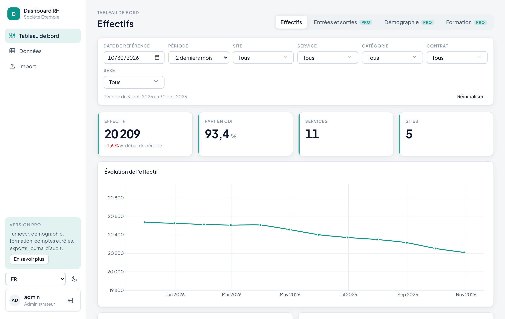
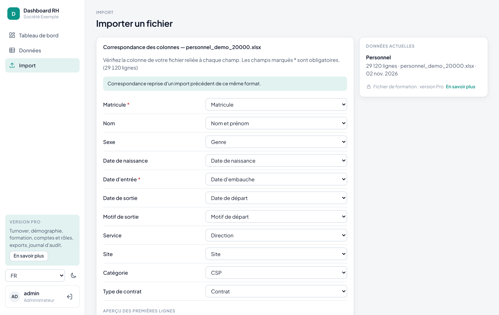
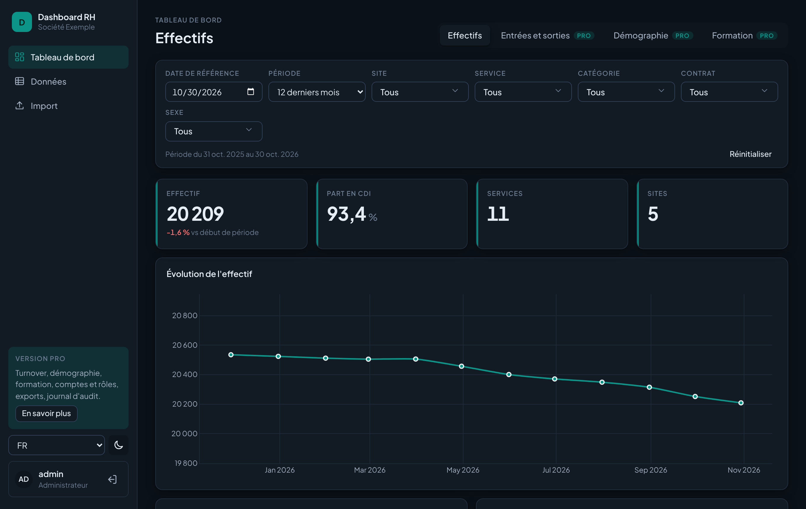

# Dashboard RH Lite

**Transformez un export Excel RH en tableau de bord des effectifs sécurisé, en quelques minutes,
sur votre propre serveur.**

[English version](README.md) · [Version Pro](#lite-ou-pro)



Dashboard RH Lite est une application web gratuite, installée chez vous, construite avec
**FastAPI, Pandas et Plotly** et une interface HTML/CSS/JS sans framework. Déposez le fichier du
personnel que vous exportez déjà de votre logiciel de paie ou RH, vérifiez la correspondance des
colonnes, et obtenez un tableau de bord des effectifs avec filtres.
Pas de cloud, pas besoin d'Internet, aucune donnée ne sort de votre réseau.

## Fonctionnalités

- **Import Excel et CSV** avec détection de l'en-tête, du séparateur et de l'encodage
- **Assistant de correspondance des colonnes** : reconnaît les en-têtes français et anglais
  (« Date d'embauche », « Hire date », « CSP », « Direction »…) et mémorise votre choix
- **Rapport de contrôle ligne par ligne**, avec le numéro de ligne Excel de chaque erreur
- **Module Effectifs** : effectif à date et variation sur la période, part en CDI, évolution
  mensuelle, répartition par service, site et catégorie
- **Filtres globaux** : date de référence, période, site, service, catégorie, contrat, sexe
- **Tableau de données** avec recherche, tri et pagination côté serveur
- **Sécurité intégrée** : mots de passe hachés (scrypt), sessions JWT, limitation des tentatives
  de connexion, Content-Security-Policy stricte, aucun secret dans le code
- Thèmes clair et sombre, français et anglais, couleur et logo configurables, affichage mobile





## Démarrage rapide

```bash
git clone https://github.com/<vous>/hr-dashboard-lite.git
cd hr-dashboard-lite
python -m venv .venv && source .venv/bin/activate     # Windows : .venv\Scripts\activate
pip install -r requirements.txt
cp .env.example .env                                  # renseignez JWT_SECRET et ADMIN_PASSWORD
python demo_data/generate.py                          # fichiers fictifs de 50, 1 000 et 20 000 salariés
uvicorn app.main:app --reload
```

Ouvrez <http://localhost:8000>, connectez-vous avec le compte `admin`, puis importez
`demo_data/personnel_demo_1000.xlsx`.

Avec Docker : `docker compose up -d --build`.

### Votre propre fichier

Une ligne par salarié, présent ou parti. Deux colonnes seulement sont obligatoires :

| Champ | Obligatoire | Exemples d'en-têtes reconnus |
| --- | :---: | --- |
| Matricule | oui | Matricule, ID salarié, Employee ID |
| Date d'entrée | oui | Date d'embauche, Date d'entrée, Hire date |
| Date de sortie | | Date de départ, Exit date (vide si présent) |
| Sexe, date de naissance, service, site, catégorie, contrat, nom, motif de sortie | | Genre, Direction, CSP, Grade, Contrat… |

L'effectif à n'importe quelle date est calculé à partir des dates d'entrée et de sortie :
inutile d'importer un fichier par mois.

## Performances

Sur une entreprise fictive de 20 000 salariés (29 120 lignes d'historique), l'import et le
contrôle prennent moins d'une seconde et le module Effectifs se calcule en environ 0,1 seconde,
puis il est servi depuis le cache jusqu'au prochain import.

## Lite ou Pro

La **version Pro** est le kit développeur complet, pour les freelances et agences qui livrent
des tableaux de bord RH à leurs clients, et pour les services informatiques internes.

| | Lite (gratuite) | Pro |
| --- | :---: | :---: |
| Import Excel/CSV, assistant de correspondance, rapport de contrôle | ✓ | ✓ |
| Module Effectifs et filtres globaux | ✓ | ✓ |
| Entrées et sorties : turnover, taux de départ, motifs de sortie | | ✓ |
| Démographie : pyramide des âges, ancienneté, mixité, 55 ans et plus | | ✓ |
| Formation : heures, taux d'accès, coût, formations les plus suivies | | ✓ |
| Tableau de données : filtres par colonne, épinglage, vues, sélection multiple | | ✓ |
| Exports CSV et Excel | | ✓ |
| Plusieurs utilisateurs et rôles (administrateur, RH, lecteur) | | ✓ |
| Journal d'audit (connexions, imports, exports) | | ✓ |
| Documentation complète, guide d'ajout de module, licence commerciale, mises à jour et support | | ✓ |

**→ [Obtenir la version Pro](PRO_URL)**

Les onglets Pro verrouillés affichés dans l'application se masquent avec `SHOW_PRO_HINTS=false`.

## Configuration

Tout se règle dans `.env` (voir `.env.example`) : nom de l'application, entreprise, couleur
d'accent, logo, langue par défaut, compte administrateur, durée de session, origines CORS,
limites de requêtes, taille des fichiers, dossier des données. En production
(`APP_ENV=production`), l'application refuse de démarrer sans `JWT_SECRET` solide.

## Développement

```bash
pip install -r requirements-dev.txt
pytest
ruff check .
```

## Licence

[MIT](LICENSE) : usage libre, personnel et commercial. La police Plus Jakarta Sans incluse est
sous licence SIL Open Font License 1.1 (`frontend/fonts/OFL-PlusJakartaSans.txt`).
La version Pro est distribuée sous une licence commerciale distincte.
