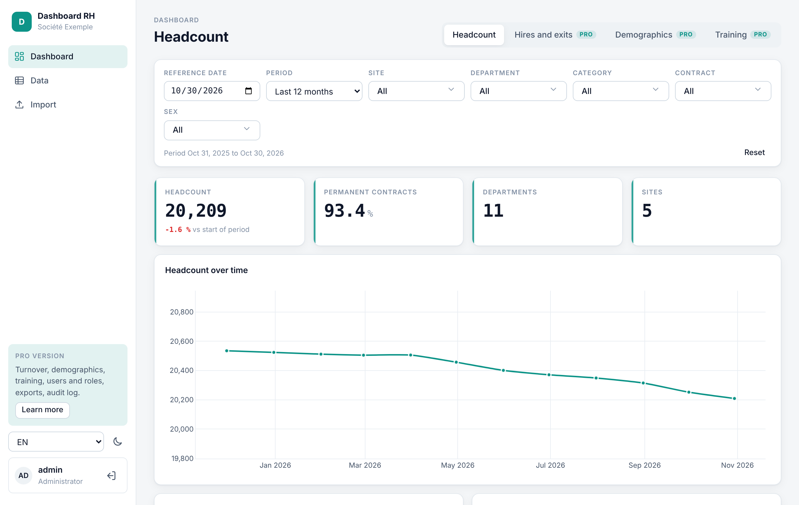
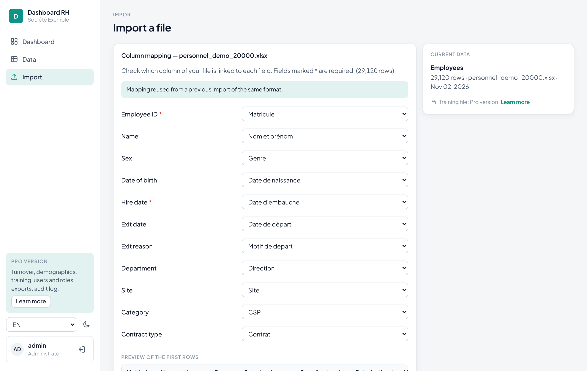
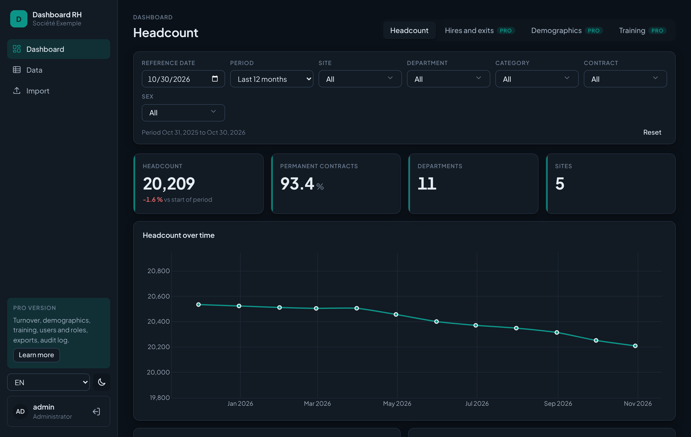

# HR Dashboard Lite

**Turn an Excel HR export into a secure headcount dashboard — in minutes, on your own server.**

[Version française](README.fr.md) · [Pro version](#lite-vs-pro)



HR Dashboard Lite is a free, self-hosted web app built with **FastAPI, Pandas and Plotly**, with a
framework-free HTML/CSS/JS front end. Drop the employee file you already export from your payroll or
HR software, check the column mapping, and get a headcount dashboard with filters.
No cloud, no internet access required, no data leaves your network.

## Features

- **Excel and CSV import** with automatic header, separator and encoding detection
- **Column-mapping assistant**: recognises French and English headers ("Date d'embauche",
  "Hire date", "CSP", "Department"…) and remembers your mapping for the next import
- **Row-level validation report** with the exact Excel line number of every error
- **Headcount module**: headcount at any date and change over the period, permanent-contract share,
  monthly trend, breakdown by department, site and category
- **Global filters**: reference date, period, site, department, category, contract type, sex
- **Data table** with server-side search, sorting and pagination
- **Security built in**: hashed passwords (scrypt), JWT sessions, login rate limiting,
  strict Content-Security-Policy, no secret in the code
- Light and dark themes, French and English, configurable brand colour and logo, responsive layout





## Quick start

```bash
git clone https://github.com/Adel1637/hr-dashboard-lite.git
cd hr-dashboard-lite
python -m venv .venv && source .venv/bin/activate     # Windows: .venv\Scripts\activate
pip install -r requirements.txt
cp .env.example .env                                  # set JWT_SECRET and ADMIN_PASSWORD
python demo_data/generate.py                          # fictional files: 50, 1,000, 20,000 employees
uvicorn app.main:app --reload
```

Open <http://localhost:8000>, sign in as `admin`, then import `demo_data/personnel_demo_1000.xlsx`.

With Docker: `docker compose up -d --build`.

### Your own file

One row per employee, current or former. Only two columns are required:

| Field | Required | Example headers recognised |
| --- | :---: | --- |
| Employee ID | yes | Matricule, Employee ID, ID salarié |
| Hire date | yes | Date d'embauche, Hire date, Start date |
| Exit date | | Date de départ, Exit date (empty if still employed) |
| Sex, date of birth, department, site, category, contract type, name, exit reason | | Genre, Gender, Direction, Department, CSP, Grade, Contrat… |

Headcount at any date is computed from hire and exit dates: no need to import one file per month.

## Performance

On a fictional company of 20,000 employees (29,120 rows of history), import and validation take
under a second and the headcount module is computed in about 0.1 s, then served from cache until
the next import.

## Lite vs Pro

The **Pro version** is the complete developer kit, for freelancers and agencies who deliver HR
dashboards to clients, and for in-house IT teams.

| | Lite (free) | Pro |
| --- | :---: | :---: |
| Excel/CSV import, mapping assistant, validation report | ✓ | ✓ |
| Headcount module and global filters | ✓ | ✓ |
| Hires & exits: turnover, exit rate, exit reasons | | ✓ |
| Demographics: age pyramid, tenure, gender balance, 55+ | | ✓ |
| Training: hours, access rate, cost, top courses | | ✓ |
| Data table: column filters, pinned columns, saved views, multi-select | | ✓ |
| CSV and Excel exports | | ✓ |
| Multiple users with roles (admin, HR, viewer) | | ✓ |
| Audit log (logins, imports, exports) | | ✓ |
| Full documentation, module guide, commercial licence, updates and support | | ✓ |

**→ Pro version launching soon. [Follow me on GitHub](https://github.com/Adel1637) to be notified.**

The locked Pro tabs shown in the app can be hidden with `SHOW_PRO_HINTS=false` in `.env`.

## Project structure

```text
app/
  config.py        all settings, read from .env
  schemas.py       canonical fields and header synonyms used by the mapping assistant
  core/            import, mapping, storage, cache, filters, headcount module
  charts/          reusable Plotly builders
  security/        passwords, JWT, rate limiting
  api/routes/      auth, import, dashboard, data
frontend/          HTML, theme CSS, ES modules
locales/           fr.json, en.json
demo_data/         fictional data generator
tests/             pytest suite
```

## Configuration

Everything lives in `.env` (see `.env.example`): app name, company, accent colour, logo, default
language, admin account, session length, CORS origins, rate limits, upload size, data folder.
In production (`APP_ENV=production`) the app refuses to start without a strong `JWT_SECRET`.

## Development

```bash
pip install -r requirements-dev.txt
pytest
ruff check .
```

## License

[MIT](LICENSE) — free for personal and commercial use. The bundled Plus Jakarta Sans font is
licensed under the SIL Open Font License 1.1 (`frontend/fonts/OFL-PlusJakartaSans.txt`).
The Pro version is distributed under a separate commercial licence.
